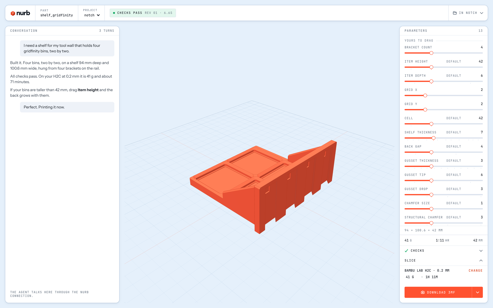

# nurb

Tell your AI what you need printed. Watch the part take shape live. Print it.

nurb turns the AI you already pay for into a CAD partner for 3D printing. You describe the part in plain words, the AI models it, and every version is measured against print physics and shown to you in a live viewer. You judge, drag sliders, click `3mf`, print.



## Get it

[**Download the app**](https://github.com/Shpigford/nurb/releases/latest/download/nurb.dmg) for Apple silicon ([Intel Macs here](https://github.com/Shpigford/nurb/releases/latest/download/nurb-intel.dmg)) , open it, and describe what you want to print. Everything is in that one window: your projects, the conversation, and the live viewer. It sets itself up the first time you open it and updates itself after that. Windows and Linux builds follow.

Then say something like:

> Make an adapter that connects my shop vac hose to the dust port on my table saw

The part appears while you read the reply. When it looks right: drag the sliders if you want, click `3mf`, print.

## Bring your own AI

The chat inside the app runs the agent you already have: Claude Code, Codex, Gemini, Cursor or Grok, on your own subscription. Prefer your own terminal? **Settings > Connect** has one copyable command each for Claude Code, the Codex CLI, and Cursor. Paste it once and that tool designs parts in your projects through the same tools the app uses, with the same live viewer showing you what it does.

**Coming from nurb 0.x?** The update brings your projects across on its own the first time 1.0 opens, parts, notes, measurements and all. A folder that doesn't make it says so, and **Import folder** brings it over by hand.

**Your parts stay on your computer.** Modelling, checking, the viewer, and export all run locally, with no nurb account. The AI you talk to runs in the cloud, so designing a part needs an internet connection.

## What you get

**A live view of every change.** Every edit updates the viewer without moving your camera. Orbit it and watch it evolve as you talk, and a build that fails leaves the last good version on screen.

**Sliders for every dimension.** Each parameter of the part gets a slider. Drag until it looks right, click `Apply`, and the change is saved where the AI sees it too.

**Print problems caught before the printer.** Thirteen printability rules run against the exact solid, not an approximation: overhangs, thin walls, floating islands, warp-prone first layers, parts that tip over. Findings pin themselves to the exact faces they fired on, so a "wall too thin" warning points at the exact spot on the model.

**Print time and filament cost up front.** The viewer's print time row drives the slicer you already have (OrcaSlicer or Bambu Studio) and answers with minutes and grams, so a design change that doubles the print time is caught while the design can still move.

**A 3MF that opens ready to print.** Exports default to 3MF with the print settings the part justifies already embedded: infill, walls, and a brim when the checks say the corners will lift. Your slicer opens it tuned. STL, STEP, and GLB are one click away.

**Parts that fit the real world.** The dimensions that matter are recorded with how they were measured, and nurb refuses to let the AI guess them. A guess has to be marked as one, and stays marked until somebody picks up a caliper. Paste a photo into the chat and the AI can look at it to recognise the product or standard it has to fit.

**Real CAD underneath.** Parts are true B-rep solids on the OCCT kernel, the same math as commercial CAD, not meshes. Chamfers and fillets are real operations, and STEP export means the part opens in Fusion or FreeCAD.

## Which model should you use?

nurb works with whatever AI subscription you already pay for, and they are not equally good at designing parts. We run the popular models through the same real part-design jobs and grade the actual geometry by machine, so you can pick based on what you subscribe to and what you are willing to spend: [nurb.app/benchmarks](https://nurb.app/benchmarks.html). The raw rows, transcripts, and grading code live in [Shpigford/nurb-benchmarks](https://github.com/Shpigford/nurb-benchmarks), and adding a row for your model is one line on your own subscription, single runs welcome:

```bash
curl -fsSL https://nurb.app/bench.sh | sh
```

## The checks

The AI cannot see, so the checks are its eyes. Rules run against the exact solid and findings come back with coordinates:

```
solids            more than one body, or none: a part that came apart
overhang          downward faces past 45 degrees, bridges told from cantilevers
floating          a region whose first layer would be laid on air
hole_ceiling      a blind hole's flat ceiling, the counterbore case
min_wall          thinnest section, ray cast corrected by an inscribed sphere
sliver            faces too small to print as anything but a smear
concave_cosmetic  polish laid into an inside corner
bed_bevel         polish laid on the edges that meet the build plate
warp_risk         large first layers with corners likely to lift as they cool
pin               a free-standing pin too thin to be more than perimeters
stability         center of mass outside the footprint
projection_ratio  reach over height, for a part cantilevered off a wall
build_volume      does it fit the printer at all
```

Findings never block the work. They are there so the AI can fix a problem before you meet it on the bed.

## Your printer

Name your machine once and every project on this computer knows the bed: the checks size themselves to it, the viewer labels the plate with it, and slicing and export use it. The first time the viewer needs to know which printer this is for, it asks, and that answer is remembered.

## Memory between sessions

AIs forget everything between sessions, so each part keeps its own history: every revision of its source, every build, and the conversation that made it. Dimensions that came from the real world are recorded with how they were obtained, and asking for one that was never measured raises an error instead of letting the model guess. No geometry check can catch a wrong guess; that failure only shows up when the printed part meets the real object.

## How parts are described

You never have to read this, but for the curious: a part is a small Python function the AI writes, and its keyword defaults are the parameters. That one line is where the viewer's sliders and the tests both come from.

```python
from nurb import *

@part
def hose_adapter(vac_end=57.6, tool_end=35.0, wall=2.4):
    ...
```

## Troubleshooting

**The first build takes about 45 seconds.** That is the CAD kernel loading cold. It stays loaded, and every change after that lands in well under a second.

**Print time says no slicer.** It drives an installed OrcaSlicer or Bambu Studio; install either and it is found automatically. Export still writes the 3MF either way.

**A check passed but the print failed on a thin wall.** `min_wall` samples faces, so a pinch nothing lands near can be missed. A clean result means "no thin walls found", not "no thin walls".

## Coming from 0.x

1.0 is the app. The `nurb` command line, the skill file and the PyPI package are gone: a project now lives in a database on your computer instead of a folder of files, which is what gives every part its revision history and keeps the app and the agent from overwriting each other. Your old folders come across with **Import folder**, and an agent in your terminal reaches the same parts through **Settings > Connect**.

Two things don't carry over. Conversations from 0.x stay behind, so each part starts a fresh chat. And the app no longer brings its own copy of Claude Code: to chat with Claude, install Claude Code once (the app shows how) and sign in.

Some 0.x tools are not in 1.0 yet: the stress button, reading phone scans and target meshes, the section plane, card variants and the hinge slider for assemblies.

## Contributing

Architecture, dev setup, testing, and the release process live in [CONTRIBUTING.md](CONTRIBUTING.md).

## License

[FSL-1.1-MIT](LICENSE). Source-available for any purpose except building a competing product, and converts to plain MIT two years after each release.

Copyright 2026 Ordinary Systems LLC.

### Third-party notices

nurb uses **Open CASCADE Technology** (OCCT) for all B-rep geometry, reached through [build123d](https://github.com/gumyr/build123d) (Apache-2.0) and the `OCP` bindings (Apache-2.0). OCCT is licensed under [LGPL-2.1 with an additional exception](https://dev.opencascade.org/resources/licensing). nurb does not redistribute OCCT; it is installed as a dependency and dynamically linked. Bundling nurb into a single-file distribution that embeds OCCT would require shipping the OCCT license and keeping the library replaceable, per LGPL.

nurb **does** redistribute [three.js](https://threejs.org) (MIT), bundled into the workbench page so it works with no network. Same for the workbench's fonts, [JetBrains Mono](https://www.jetbrains.com/lp/mono/) and [Instrument Sans](https://github.com/Instrument/instrument-sans), both SIL OFL 1.1.

Other dependencies: trimesh (MIT), websockets (BSD-3-Clause), numpy (BSD-3-Clause), and the official MCP SDK `mcp` (MIT), which brings starlette, uvicorn, httpx2, pydantic and jsonschema with it: 27 packages and about 27 MB in a bare venv, measured on mcp 2.2.0. Pillow (MIT-CMU) downscales reference photos before a model reads them.
